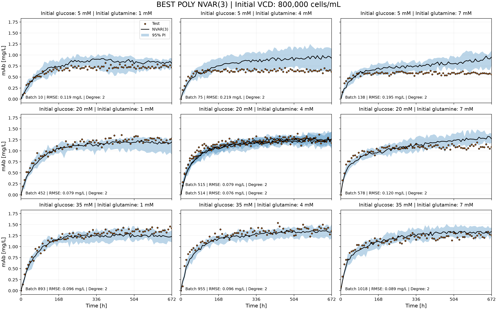
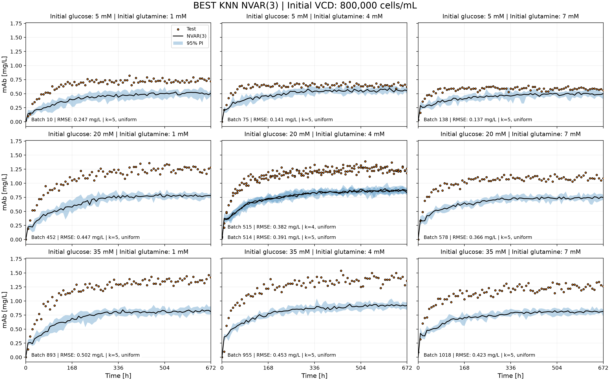

# mAb Production Optimization Using Machine Learning

This project uses nonlinear time-series models to forecast monoclonal antibody (mAb) production and identify profitable batch operating conditions. It compares polynomial regression and k-nearest neighbors using 30 simulated batch datasets. Forecasts are combined with culture costs and reactor downtime to recommend initial glucose, glutamine, viable cell density, and harvest time that maximize space-time profit within the selected conditions.

## Highlights

- Designed a batch selection covering low, middle, and high initial conditions, with three additional replicates.
- Built nonlinear vector autoregressive models to forecast seven interacting culture variables.
- Evaluated forecast accuracy using leave-one-batch-out validation and grouped hyperparameter tuning.
- Estimated forecast uncertainty through repeated simulations with sampled training residuals.
- Compared economic outcomes to identify profitable operating conditions and harvest times.

## Environment

- Python 3.14.7
- Matplotlib 3.11.0
- NumPy 2.5.2
- pandas 3.0.5
- scikit-learn 1.9.0

The program also uses the Python standard-library modules `functools`, `os`, and `sys`.

## Code Design

### Loading and organizing the batch data

When `main.py` runs, it loads the selected `batch_*.csv` files from `datasets/` and combines them into one table. Each file receives a batch identifier so observations from different runs remain distinguishable. The program also loads `initial_conditions.csv` and keeps the entries matching the selected batches.

Seven process variables are included: glucose, glutamine, lactate, ammonia, viable cell density (VCD), total cell density (TCD), and mAb concentration. Modeling them together allows the forecast to use information about the changing culture state. Although all seven variables are predicted, mAb concentration, being the desired product, is used to compare the models tested.

### Building lagged inputs and scaling variables

The time series are converted into input–target pairs. For an autoregressive order of p, each input contains the previous p states of all seven variables, and its target contains their values at the next time point. Pairs are built separately within each batch to avoid joining the end of one run to the beginning of another.

The custom scaler standardizes each process variable using training data. All lagged copies of a variable use the same scaling statistics. This prevents the large numerical values of cell density from dominating smaller concentration values, particularly when calculating distances for k-nearest neighbors. Keeping scaling inside the pipeline also prevents validation data from influencing the fitted scaling parameters.

### Training and selecting hyperparameters

The program evaluates polynomial regression and k-nearest neighbors for p values from 1 to 4. An outer leave-one-batch-out loop holds out one batch and trains on the other 29. This repeats until every batch has served as the test batch.

Within each training set, a three-fold grouped grid search selects polynomial degree or neighbor count. Individual batches remain together within each fold to prevent including data points from neighboring time series. Hyperparameters are selected using mAb RMSE. The model is then tested on how well it predicts a complete batch from its initial conditions.

### Forecasting and estimating uncertainty

Each held-out batch is forecast from its known initial conditions. Lactate, ammonia, and mAb start at zero, while TCD starts equal to VCD. Predictions are fed back into the model to generate subsequent states. When fewer than p states are available, the earliest available state is repeated to fill the lag history.

Ten simulations are generated for each test batch and model configuration. Residuals are calculated as observed minus predicted training values. Each step adds a randomly sampled training residual for each variable. Predictions are first kept within the range of values seen in the training data. After adding random noise, any negative values are set to zero. At each time point, the median of the 10 simulations is used as the main prediction, while the 2.5th and 97.5th percentiles give an estimated 95% prediction interval.

### Comparing forecasts and calculating economics

The program calculates mAb RMSE for each held-out batch, then reports its mean and standard deviation across the 30 batches. It selects the lowest-RMSE p within each model family for plotting and economic analysis. The model with the lowest overall mean RMSE is taken as the final forecast-based recommendation.

The program calculates economic results at every available harvest time after time zero, using both the selected models’ predictions and the reference data. It converts hours to days, subtracts culture costs from product value, and divides the profit by the total cycle time, including downtime.
It then finds the most profitable harvest time for each batch and the most profitable batch for each model and the reference data. The lower and upper mAb predictions are also used to calculate prediction intervals for culture value, space-time profit, and space-time yield. Results are saved as CSV files in tables/, and graphs are saved in figures/.

## Analysis

### Selection of the 30 batches

The batch selection uses three levels for each initial condition:

| Initial condition | Low | Middle | High |
| --- | ---: | ---: | ---: |
| Glucose [mM] | 5 | 20 | 35 |
| Glutamine [mM] | 1 | 4 | 7 |
| VCD [cells/mL] | 200,000 | 800,000 | 1,400,000 |

All 27 combinations were included, giving broad coverage of the selected operating range. This makes it possible to compare nutrient and inoculum effects together, including cases where the effect of one variable depends on another. Using only a narrow range could miss these interactions or make the recommendation depend too strongly on a small region.

The remaining three batches repeat the all-low, all-middle, and all-high conditions. These provide limited information about variability at the center and two opposite corners while keeping most of the budget available for coverage. They do not establish repeatability across the entire design.
The three extra batches repeat the conditions where all starting values are low, middle, or high.

### Model architecture and performance

Nonlinear vector autoregression was chosen because culture variables change together over time and their relationships may be nonlinear. Polynomial regression captures curved responses and interactions through explicit polynomial terms. Degrees 2 and 3 were tested to limit complexity and runtime.
k-nearest neighbors predicts the next values by averaging the results from similar situations in the training data. Between 2 and 5 neighbors were tested, with each neighbor given equal weight.

| Model | p | Mean forecast RMSE [mg/L] | SD across batches [mg/L] |
| --- | ---: | ---: | ---: |
| Polynomial | 1 | 0.226 | 0.136 |
| Polynomial | 2 | 0.156 | 0.084 |
| Polynomial | 3 | **0.133** | 0.062 |
| Polynomial | 4 | 0.213 | 0.174 |
| kNN | 1 | 0.249 | 0.166 |
| kNN | 2 | 0.236 | 0.151 |
| kNN | 3 | **0.221** | 0.140 |
| kNN | 4 | 0.231 | 0.150 |

Polynomial NVAR(3) achieved approximately 40% lower mean RMSE than the best kNN configuration. Degree 2 was selected in every displayed polynomial NVAR(3) test fold. Both models performed best at p = 3, and adding a fourth lag did not improve these results. Polynomial NVAR(3) was therefore selected for the recommendation, as it resulted in the lowest rmse value.

The figures also show limitations hidden by the averages. Polynomial forecasts overpredict several low-glucose batches, especially at high initial VCD. kNN underpredicts many batches at middle VCD. Consequently, neither model performs equally well throughout the design.

Polynomial regression can capture how the variables affect each other, but small errors can build up as predictions are used to make further predictions. kNN provides a useful comparison, although averaging similar training examples can make it miss the behavior of a new batch. Since k = 5 was often selected, the highest value tested, it would be useful to try with a higher neighbor number. Also, the model settings are chosen based on how well they predict one time step ahead, so they may not be the best settings for predicting an entire batch.

### Economic objective and effects of initial conditions

The results use 1 day of downtime between batches. With harvest time t in days and mAb concentration M in mg/L, the economic calculations are:

$$
C = 10G_0 + 20Q_0 + 0.0005X_0
$$

$$
V = 1000M, \qquad P = V-C
$$

$$
\text{Space-time profit} = \frac{P}{t+1}
$$

$$
\text{Space-time yield} = \frac{M}{t+1}
$$

Here, G₀ and Q₀ are the initial glucose and glutamine concentrations in mM, and X₀ is the initial VCD in cells/mL. C, V, and P represent culture cost, culture value, and profit in $/L.

Increasing nutrients or inoculum is worthwhile only when the resulting production gain compensates for added cost. At fixed harvest time, increasing initial glucose from 5 to 35 mM adds $300/L; increasing glutamine from 1 to 7 mM adds $120/L; and increasing VCD from 200,000 to 1,400,000 cells/mL adds $600/L. Space-time yield does not subtract these costs, so maximizing it can favor different conditions from maximizing profit.

The reference data illustrate this tradeoff. At 20 mM glucose and 4 mM glutamine, increasing VCD from 200,000 to 800,000 cells/mL increased the best sampled space-time profit from $55.00/(L d) to $92.31/(L d). Increasing VCD further to 1,400,000 cells/mL reduced it to $58.24/(L d). At 800,000 cells/mL and 4 mM glutamine, increasing glucose from 20 to 35 mM also reduced the best profit, to $67.20/(L d). More starting material therefore did not consistently produce a better economic outcome.

Harvest timing matters because additional production occupies the reactor for longer. Once the mAb concentration approaches a plateau, waiting adds little product while increasing the cycle time. The profit calculation accounts for this reactor unavailability against the value of further production. Downtime is included because the reactor cannot immediately start another batch. All estimates use a simplified cost model; additional operating, purification, and capital costs are outside its scope.

### Recommended conditions and comparison with reference data

The model with the lowest average forecast RMSE is selected first. Its predictions are then used to find the conditions and harvest time with the highest space-time profit. This strategy was used as choosing a model simply because it predicts the highest profit could favor one that overestimates mAb production.

| Quantity | Polynomial recommendation | kNN optimum | Reference-data optimum |
| --- | ---: | ---: | ---: |
| Batch ID | 444 | 507 | 515 |
| Initial glucose [mM] | 20 | 20 | 20 |
| Initial glutamine [mM] | 1 | 4 | 4 |
| Initial VCD [cells/mL] | 200,000 | 200,000 | 800,000 |
| Harvest time [d] | 4.00 | 2.00 | 3.33 |
| Culture cost [$/L] | 320.00 | 380.00 | 680.00 |
| mAb at harvest [mg/L] | 0.744 | 0.828 | 1.080 |
| Culture value [$/L] | 744.14 | 828.00 | 1,080.00 |
| Profit [$/L] | 424.14 | 448.00 | 400.00 |
| Space-time profit [$/(L d)] | 84.83 | 149.33 | 92.31 |
| Space-time yield [mg/(L d)] | 0.1488 | 0.2760 | 0.2492 |

The 95% prediction intervals below apply to the polynomial recommendation at the fixed 4-day harvest time. Culture cost is fixed at $320/L.

| Quantity | Median estimate | 95% prediction interval |
| --- | ---: | ---: |
| Culture value [$/L] | 744.14 | 597.46–815.15 |
| Space-time profit [$/(L d)] | 84.83 | 55.49–99.03 |
| Space-time yield [mg/(L d)] | 0.1488 | 0.1195–0.1630 |

The polynomial model recommends starting with fewer cells and less glutamine to keep costs low. However, batch 444 actually contains only 0.450 mg/L of mAb at day 4, giving a space-time profit of $26.00/(L d), compared with the predicted $84.83/(L d). This shows that having the lowest average RMSE does not guarantee an accurate profit prediction. The best result in the reference data instead uses the middle starting cell density and glutamine concentration. The recommended conditions therefore need further testing.

These are optima among the selected batches and sampled times, rather than a continuous or global optimization. Replicates are ranked separately, so a particularly favorable noisy observation can influence the reference optimum. Averaging replicate responses and testing additional conditions near promising regions would strengthen the comparison.

### Uncertainty, limitations, and next steps

Residual sampling assumes that errors remaining after model fitting behave like random noise rather than containing patterns the model might have failed to learn. This assumption could be wrong. A white-noise analysis could be conducted to check residual means, autocorrelation, and changes in patterns over time for all seven variables. Sampling each variable independently also ignores correlations between their errors. Errors measured on the training data may make predictions for new batches seem more certain than they really are. In several graphs, the reference values stay outside the prediction intervals for long periods.

To reduce runtime, only 10 simulations per condition and four p values tested. More simulations would stabilize the median and especially the tail percentiles; they would not automatically remove model bias. Testing more p values and model settings could improve predictions, but these choices would need to be checked through validation. Keeping predictions within set limits helps prevent unrealistic values, but it does not ensure that they follow mass balances or biological rules. Also, when one batch is used for testing, another batch with the same initial conditions may remain in training. The evaluation therefore does not always show how well the model predicts completely new starting conditions.

Economic prediction intervals are calculated by applying the economic equations to the lower and upper mAb forecast bounds at the same harvest time. They assume fixed costs and downtime and remain conditional on the selected model and operating point. For batch 444 at day 4, the reference culture value is below the predicted interval, showing that the sampled errors do not fully capture the model’s tendency to overpredict. These intervals describe uncertainty in the economic results at the selected conditions; they do not show whether those conditions and harvest time are truly most optimal.

Supporting results are available in [model comparison](tables/model_comparison.csv), [all harvest times](tables/economics_all_harvest_times.csv), [best harvest per batch](tables/economics_best_harvest_per_batch.csv), and [economic optima](tables/economics_optima.csv).

